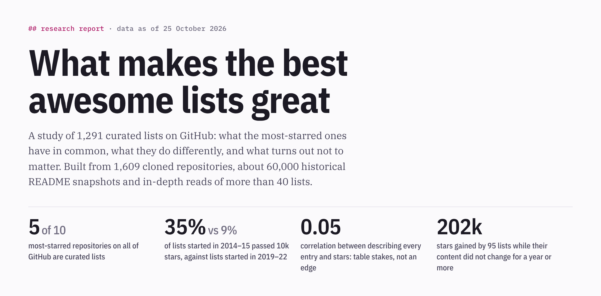
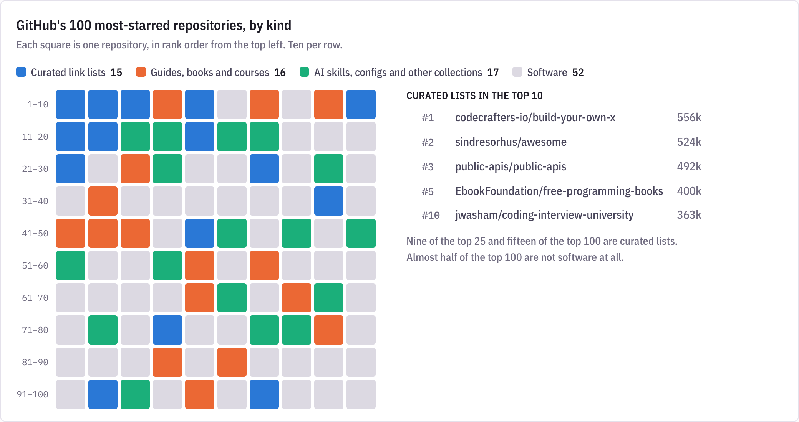
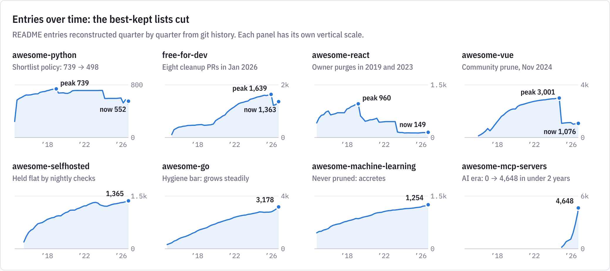
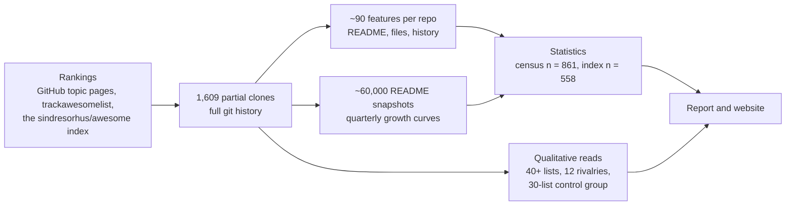

<div align="center">

<a href="https://depuschm.github.io/awesome-lists-research">
  <picture>
    <source media="(prefers-color-scheme: dark)" srcset="assets/readme/hero-dark.png">
    
  </picture>
</a>

[](https://depuschm.github.io/awesome-lists-research)
[](REPOSITORIES.md)
[](data/)

**[Interactive report](https://depuschm.github.io/awesome-lists-research)** · **[Report in Markdown](REPORT.md)** · **[All 1,609 repositories](REPOSITORIES.md)** · **[Data](data/)** · **[Analyst notes](notes/)**

</div>

<br>

What makes GitHub's most-starred "awesome" lists so good? This study measured 1,291 curated lists: their stars, structure, history and governance. It draws on 1,609 cloned repositories, about 60,000 historical README snapshots, a same-topic rivals comparison, a random sample of small lists and in-depth reads of more than 40 lists.

## What separates the winners

| Separates the top lists | Barely matters |
|---|---|
| **Arriving when a topic is born.** 35% of lists started in 2014–15 passed 10k stars, against 9% of lists started in 2019–22. The AI wave opened a second window. | **Describing every entry.** Correlation with stars: 0.05. Small lists do it as often as giant ones. |
| **Scale and breadth.** Lists with 50k+ stars have a median of 593 entries in 51 categories; lists under 2k stars have 146 in 18. | **Table of contents, badges, licence.** Equally common at every tier. |
| **Growing for years after launch.** Half of the 50k+ lists more than doubled after year one, against a quarter of small lists. | **The official rules.** The Awesome badge, awesome-lint and Creative Commons licences are no more common at the top; inside the index, small lists follow them more often (badge: 99% vs 77%). |
| **Pruning on purpose.** 23% of 50k+ lists are now at least 10% smaller than their peak, against 8% of small lists. | **Being bigger than a live incumbent.** Six late clones that launched larger or better maintained got 1–7% of the leader's stars. |
| **Process.** PR templates (46% vs 14%), issue forms (36% vs 10%), CI (55% vs 37%), rules turned into bots. | **The repo name.** Identical names in 7 of 12 rivalries; the name decided none of them. |
| **Distribution.** An index slot, a website, an existing audience: every overtake in the rivals study had one. | **Alphabetical order, a code of conduct.** Correlations with stars: 0.07 and 0.00. |

<br>

<picture>
  <source media="(prefers-color-scheme: dark)" srcset="assets/readme/top100-dark.png">
  
</picture>

<picture>
  <source media="(prefers-color-scheme: dark)" srcset="assets/readme/dumbbell-dark.png">
  
</picture>

<picture>
  <source media="(prefers-color-scheme: dark)" srcset="assets/readme/growth-dark.png">
  
</picture>

## Ten things the best lists do

1. **Claim a canonical slot early, and keep earning it.** The big ecosystem catalogs were all created within 19 days in 2014; the AI-era winners launched days to weeks after their platform.
2. **Answer one recurring question.** "I want to do X in Python, which tool should I use?" Then defend the scope in writing.
3. **Curate by deciding.** awesome-python caps each use case at 5 entries, and a newcomer must name the entry it replaces; awesome-go demands a release, docs and 80% test coverage.
4. **Put decision metadata in every entry:** auth/HTTPS/CORS columns (public-apis), free-tier limits (free-for-dev), licence and platform tags (awesome-selfhosted).
5. **Launch full, then grow for years.** One-shot launches are a third of a random sample of small lists, and none of the four biggest.
6. **Prune on purpose, and write down why.** "remove X (unmaintained since 2025-09-04)".
7. **Turn the README into a pipeline:** data files as the source of truth, rules as bots, contributors supplying the evidence.
8. **Build distribution into the list:** backlink badges, websites and `llms.txt`, communities, Hacktoberfest.
9. **Ship original content or artifacts, not only links:** shell one-liners, hosted papers, prompt and skill files.
10. **Keep a voice, and keep neutrality.** Sponsors stay out of the entries; where owners mixed them in, quality measurably eroded.

The evidence for each is in [section 5 of the report](REPORT.md#5-ten-things-the-best-lists-do), together with [same-topic rivalries](REPORT.md#6-same-topic-rivals-a-natural-experiment), [why most lists stay small](REPORT.md#7-why-most-lists-stay-small) and [the 2026 AI inflection](REPORT.md#9-2026-the-ai-inflection).

## How the study was done



Statistics run on two unbiased samples: a **census** of every curated list among the 1,000 most-starred repositories tagged `awesome-list` (n = 861), and **every list in the official [sindresorhus/awesome](https://github.com/sindresorhus/awesome) index** with a known star count (n = 558).

> [!NOTE]
> - Stars are a proxy for reach and bookmarking as much as quality. Star histories were not available, so growth is measured in README content.
> - Results are correlations. Contributor counts and governance files are partly consequences of popularity.
> - The qualitative notes were written by AI sub-agents working from the cloned repositories and their git history; the most surprising claims were spot-checked against the repositories.
> - `data/topic_awesome-list_p3-26.tsv` also contains 60 rows from pages 28–30, written there by a parallel scraper; `scripts/merge_rankings.py` keeps only rows whose page falls in each file's range.

## Which repositories were studied

All 1,609 repositories are listed in [REPOSITORIES.md](REPOSITORIES.md), each linked to the exact commit that was analysed: 1,291 curated lists in the statistics, plus the repos that were cloned and then excluded (not lists, duplicates, no star data) and the few used only for qualitative comparison. The same list is in [`data/repositories.tsv`](data/repositories.tsv) for scripts. The repositories themselves are not included, as copies or as submodules, to keep this repo small; `scripts/clone_one.sh owner/repo <sha>` re-creates any snapshot.

<details>
<summary><b>Repository layout</b></summary>

<br>

| Path | Contents |
|---|---|
| `REPORT.md` | The full report |
| `REPOSITORIES.md` | Every repository studied, with its status and a link to the exact commit analysed |
| `docs/index.html` | The report as a web page with interactive charts, served by GitHub Pages |
| `page/awesome-lists-study.html` | The same page as an HTML fragment (for embedding viewers that supply their own document skeleton) |
| `assets/` | README images (light and dark) and a social preview card |
| `notes/` | Literature review, five archetype deep dives, same-topic rivals study, low-star control group, analyst rubric |
| `data/repositories.tsv` | The same list, machine-readable: status, stars, census/index membership, pinned commit SHA and date |
| `data/master_stars.tsv` | 1,598 repositories with stars from every source, index membership and category |
| `data/corpus.csv` | 1,568 repositories × ~110 features, with classification |
| `data/features.jsonl` | Raw extracted features, one JSON object per repository |
| `data/readme_history_final.jsonl` | Quarterly README size and entry counts for 1,609 repositories |
| `data/analysis/` | Tier comparisons, correlations, cohorts, regressions, dormant-star growth, chart data |
| `data/topic_*.tsv`, `data/tal_lists.tsv`, `data/awesome_index.tsv` | Raw rankings and index parses |
| `data/manual_kind.csv`, `data/archetypes_top.csv` | Manual classifications |
| `raw/` | Source snapshots (trackawesomelist README, EvanLi/Github-Ranking top 100) |
| `scripts/` | The full pipeline |

</details>

<details>
<summary><b>Reproducing the analysis</b></summary>

<br>

Requires Python 3.13 and git (and Node.js with Playwright for the README images).

```sh
python3 -m venv .venv && .venv/bin/pip install -r requirements.txt

# 1. Clone every repository at the exact commit analysed (partial, sparse clones; ~2.6 GB)
tail -n +2 data/repositories.tsv | awk -F'\t' '$11 != "" {print $1, $11}' | xargs -P 8 -n 2 scripts/clone_one.sh

# 2. Extract features and reconstruct README histories
ls -d clones/*/ | xargs -P 4 -n 25 python3 -I scripts/extract.py > data/features.jsonl
ls -d clones/*/ | xargs -P 4 -n 10 python3 -I scripts/readme_history.py > data/readme_history_final.jsonl

# 3. Build the corpus, run the statistics, rebuild the page
.venv/bin/python scripts/build_corpus.py
.venv/bin/python scripts/analyze.py
.venv/bin/python scripts/export_viz.py
.venv/bin/python scripts/build_page.py    # writes docs/index.html and page/awesome-lists-study.html
.venv/bin/python scripts/make_manifest.py # rewrites REPOSITORIES.md and data/repositories.tsv from clones/
node scripts/make_readme_images.js        # rewrites the README images from docs/index.html
```

Cloning at the pinned commits reproduces the analysed snapshots; time-based features are measured against a fixed date (25 October 2026), and star counts are fixed snapshots in `data/`. If a list's owner has rewritten its history, the pinned commit may be gone and `clone_one.sh` warns and falls back to the current version. The rankings in `data/topic_*.tsv` were collected from GitHub topic pages, whose star counts are rounded.

</details>

## License

- **Report, notes, data, web page and images:** [Creative Commons Attribution 4.0 International (CC BY 4.0)](LICENSE). You may share and adapt them for any purpose, including commercially, as long as you give credit and link back to this repository.
- **Code in `scripts/`:** [MIT](scripts/LICENSE).
- **Third-party material keeps its own terms.** `raw/` holds snapshots of files from [trackawesomelist](https://github.com/trackawesomelist/trackawesomelist) and [EvanLi/Github-Ranking](https://github.com/EvanLi/Github-Ranking). Repository names, descriptions and quotations from the studied lists belong to their authors and are reproduced for research and commentary.

## Credits

Research and analysis by Claude (Anthropic), commissioned by depuschm.
